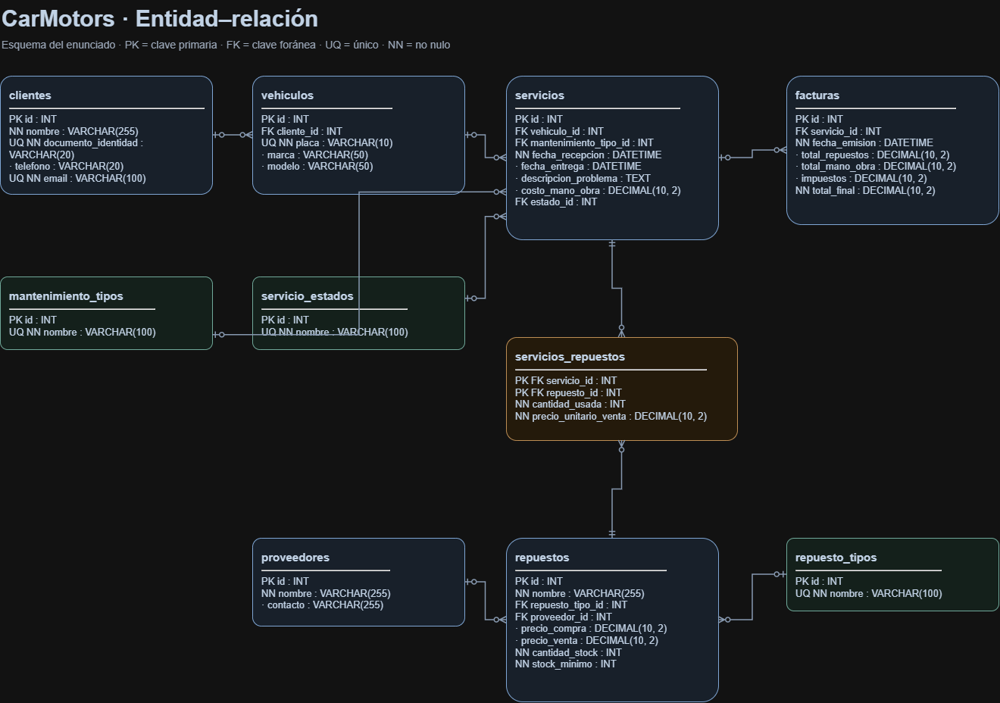

# Sistema de Gestión para el Taller Automotriz CarMotors

CarMotors gestiona clientes, vehículos y órdenes de servicio de un taller automotriz. El proyecto también incluye módulos de inventario y reportes pendientes de conectar al menú.

## Tecnologías

Java 17, MySQL 8, JDBC, Maven y consola.

## Funcionalidades de órdenes

- Crear órdenes para un vehículo y un tipo de mantenimiento registrados.
- Consultar una orden, listar órdenes y consultar sus técnicos.
- Asignar técnicos existentes sin duplicar la misma asignación.
- Validar identificadores positivos, descripción obligatoria y mano de obra entre
  0 y 99999999.99, con hasta dos decimales. Las órdenes nacen en estado Pendiente.
- Confirmar o revertir la transacción de asignación de técnicos.

## Estado de los demás módulos

- **Clientes y vehículos:** registro, consulta del historial y recordatorios de mantenimiento preventivo desde la consola.
- **Inventario y proveedores:** catálogo, lotes, evaluaciones, alertas y reservas implementados en el servicio y el controlador. Quedan pendientes el acceso desde el menú y la integración de reservas y descuentos con el ciclo de órdenes.
- **Reportes y facturación:** reportes de servicios, productividad y consumo de repuestos, además del subtotal de una orden completada. Quedan pendientes el acceso desde el menú, la emisión de la factura y el ciclo de estados hasta la entrega.

## Base de datos

`database/schema.sql` crea las tablas necesarias para órdenes: clientes y vehículos,
tipos de mantenimiento, estados, servicios, técnicos y la relación servicios-técnicos.
Un vehículo pertenece a un cliente; cada servicio referencia vehículo, tipo y estado.
Un servicio puede tener varios técnicos y un técnico puede atender varios servicios.



Los scripts de lotes, evaluaciones y reservas complementan el esquema base para las pruebas de inventario.

## Instalación y ejecución

Requisitos: JDK 17 o superior, Maven y MySQL Server 8.

1. Clonar el repositorio privado usando su URL y entrar en `proyecto-java-grupo06`:
   ```powershell
   git clone <URL-del-repositorio>
   cd proyecto-java-grupo6/proyecto-java-grupo06
   ```
2. Abrir el cliente MySQL desde el directorio del proyecto y ejecutar los scripts sobre una instalación de prueba nueva:
   ```sql
   SOURCE database/schema.sql;
   SOURCE database/data.sql;
   ```
   Estos scripts se ejecutan una vez sobre una base nueva; no son una migración
   para una base que ya contiene las tablas.
3. Configurar la conexión en la terminal PowerShell:
   ```powershell
   $env:CARMOTORS_DB_URL = 'jdbc:mysql://localhost:3306/carmotors'
   $env:CARMOTORS_DB_USER = 'tu_usuario'
   $env:CARMOTORS_DB_PASSWORD = 'tu_clave'
   ```
4. Compilar y ejecutar:
   ```powershell
   mvn clean compile exec:java
   ```
   Los datos de ejemplo incluyen vehículo, tipo de mantenimiento y técnico con ID 1.

## Pruebas

Compila las clases de prueba con `mvn test-compile` y ejecuta sus métodos `main` desde el IDE. Las clases ejecutables son `com.carmotors.OrdenServicioPrueba`, `com.carmotors.ReportesDia2Prueba` y `com.carmotors.ReportesDia3Prueba`.

- Sin argumentos, las pruebas cubren validaciones de órdenes, cálculos de reportes y datos de facturación sin abrir conexiones.
- Con `--mysql`, usa una base exclusiva de pruebas y las variables de conexión indicadas arriba. Los datos de reportes están incluidos en `database/data.sql`. Consulta los [resultados esperados](docs/reportes-resultados-esperados.md).
- El modo `--h2` de órdenes falla al cargar `schema.sql` porque H2 rechaza la sentencia MySQL `CREATE DATABASE`.

Se verificó la compilación con compatibilidad Java 17 y pasaron las tres pruebas sin base de datos. La ejecución contra MySQL queda pendiente.

## Decisiones de diseño

- MVC: `MenuPrincipal` recoge y presenta datos; `OrdenServicioControlador` delega
  las peticiones; `OrdenServicio` representa la entidad.
- Servicio: `OrdenServicioServicio` concentra validaciones y transacciones.
- DAO: cada DAO de órdenes contiene el SQL de su entidad o relación.
- Singleton: `ConexionFactory` ofrece una única fábrica, con conexiones independientes.
- Factory: la fábrica encapsula la creación de conexiones JDBC.
- Inyección de dependencias: servicio, controlador y vista reciben sus colaboradores.
  La interfaz funcional `Conexiones` permite probar validaciones sin una base real.
- Responsabilidad única: presentación, coordinación, negocio y persistencia se separan.
  La adquisición de conexiones depende de una abstracción en el servicio.
- Lambdas y Stream: búsqueda de estados del catálogo y recorrido de órdenes.

## Autores

Grupo 6. Los nombres completos deben completarse con los datos de los integrantes.
